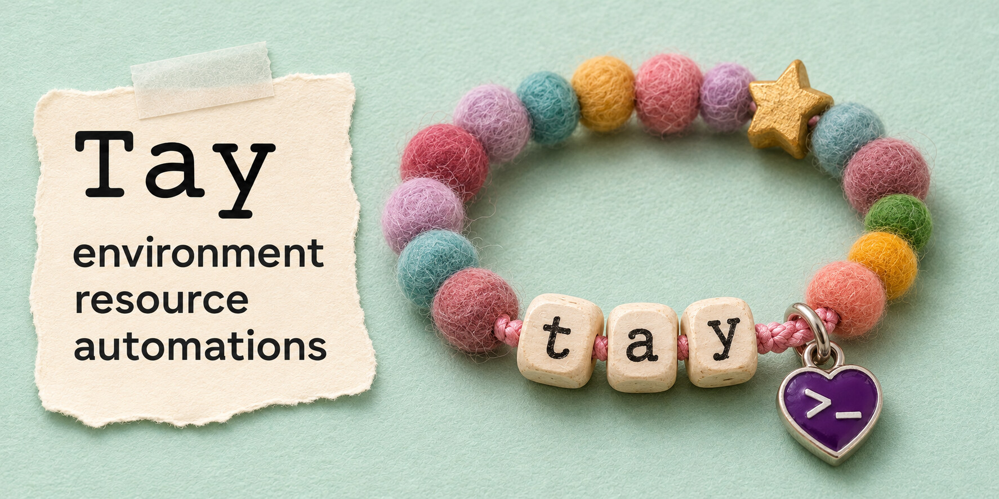

# Tay



**Topology Automation via YAML.**

Tay brings a whole software stack up from one command, then keeps reporting what is building, what is ready, and what failed and why.

Each checkout gets its own environment and daemon, so multiple git worktrees can run independent copies of a stack on one machine. YAML in the project's own repository describes units (host processes, containers, one-off commands, ports, files, and secrets) and the dependencies between them. The same stack definitions work locally and on a server.

## A first stack

Put this in an empty folder as `tay.yaml`:

```yaml
format: 1
stack: hello
up: [web]

units:
  cache:
    doc: A Redis container, ready once it answers a ping.
    uses: container
    with:
      image: redis:7-alpine
    ready: { command: ["redis-cli", "ping"], within: 30s }

  web-port:
    doc: A free port on this machine, kept for this folder from then on.
    uses: port

  web:
    doc: A web server on the host, started once the cache is ready.
    uses: process
    needs: [cache]
    with:
      command: ["python3", "-m", "http.server", "${web-port.number}", "--bind", "127.0.0.1"]
    ready: { http: "http://127.0.0.1:${web-port.number}/", within: 30s }
```

Then, in that folder:

```
$ tay up
  web-port  starting  making it
  cache     starting  attempt 1, starting
  web       waiting   for `cache`, `web-port`
  web-port  ready     28470
  web       waiting   for `cache`
  cache     starting  attempt 1, waiting to be ready: command `redis-cli ping`
  cache     ready     attempt 1, command `redis-cli ping` passes
  web       starting  attempt 1, starting
  web       starting  attempt 1, waiting to be ready: http http://127.0.0.1:28470/
  web       ready     attempt 1, http http://127.0.0.1:28470/ passes
tay up: everything asked for is ready.
tay up: it took 0.5s.
```

`tay up` returns when everything asked for is ready, or when something can no longer become ready, and says which. What it started keeps running. A launch announcement is not a health check: a unit that says how to tell it is ready is `ready` only when that check passes.

| Command | What it does |
|---|---|
| `tay plan` | Checks the definitions and prints what would come up, in order, and why. Starts nothing |
| `tay up` | Brings the stack up and returns when it is ready |
| `tay status` | Each unit's state, checked now |
| `tay logs web --follow` | What a unit wrote, with the time of each line |
| `tay restart web` | Stops a unit and starts it again |
| `tay down` | Stops everything. Ports, secrets, files and volumes are kept |
| `tay wipe --all --yes` | Removes everything the folder's environment keeps |

## What it is for

- **One command from a fresh checkout.** Builds, containers, databases, set-up steps and the services that need them come up in the order they need each other, and a step that is already done is not done again.
- **The truth about state.** Every unit is `waiting`, `starting`, `ready`, `unready`, `failed` or `stopped`, with the reason, and a failure names the unit, shows the last lines it wrote, and names what was waiting on it.
- **Many environments on one machine.** Each folder that holds a stack is an environment of its own, with its own ports, secrets, containers, network and volumes, so two checkouts of one project run side by side.
- **Strict definitions.** A mistake in the YAML is an error with its file, line and column, found by `tay plan` before anything starts. All of a stack's errors are reported in one run.
- **Nothing lost when the daemon stops.** One daemon per environment starts on demand. If it dies, the stack keeps running, and the next command starts a daemon that finds everything again.
- **Rebuild on save.** A unit that watches its sources is built again when one changes, and only what uses the result is restarted.
- **The same definitions on a server.** A profile chooses what comes up and how: from source on a developer's machine, from images on a server, where `tay serve` runs under systemd.

## Installing

Tay runs on macOS and Linux. Container units need Docker; nothing else does.

```
cargo install tay --locked
```

needs Rust 1.93 or later. Built programs for Linux and macOS are attached to each [release](https://github.com/synestheticsystems/tay/releases). To build the newest source instead:

```
cargo install --git https://github.com/synestheticsystems/tay --locked
```

[View on crates.io](https://crates.io/crates/tay)

## Status

The placeholder era is over. Version 0.1 is young, and it runs real stacks: Tay was written to replace a product's own development tool, and brings that product's stack of about a hundred units up on a developer's Mac and on a Linux server.

Its two contracts are [docs/definition-format.md](docs/definition-format.md), what a stack's definitions may say, and [docs/engine.md](docs/engine.md), what Tay does with them. A sentence in either that says something is not built yet means exactly that.

## Licence

Licensed under either of

- Apache License, Version 2.0 ([LICENSE-APACHE](LICENSE-APACHE))
- MIT license ([LICENSE-MIT](LICENSE-MIT))

at your option.
